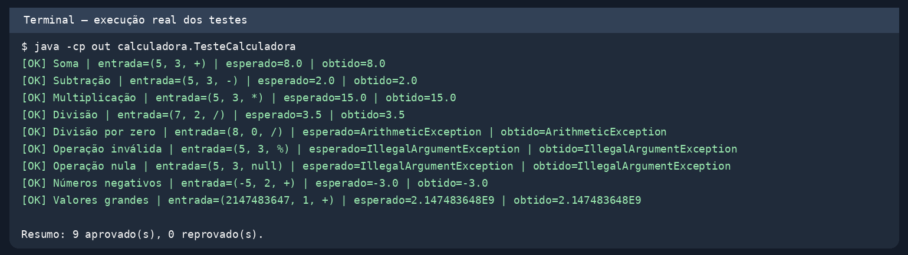
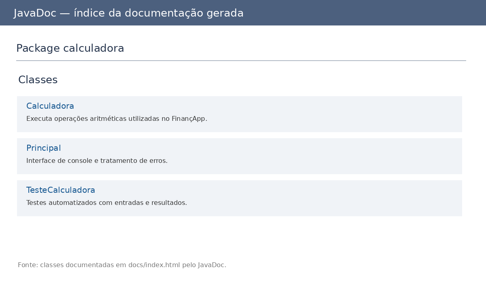

# FinançApp — Projeto Calculadora

## Descrição
Calculadora Java para operações matemáticas básicas usadas no aplicativo fictício FinançApp.
O programa oferece uma interface no console, mensagens de erro, testes automatizados e documentação JavaDoc.

## Objetivo da atividade
Praticar construção, validação, testes unitários, tratamento de erros, refatoração,
documentação técnica e versionamento com Git e GitHub.

## Tecnologias utilizadas
- Java 17+ (compilado e testado com OpenJDK 21)
- JavaDoc (incluído no JDK)
- Git e GitHub
- Testes escritos em Java puro, sem dependências externas

## Estrutura do projeto
```text
projeto_calculadora/
├── src/calculadora/
│   ├── Calculadora.java
│   ├── Principal.java
│   └── TesteCalculadora.java
├── docs/                   # documentação JavaDoc gerada
├── prints/                 # evidências de testes e documentação
├── README.md
└── .gitignore
```

## Operações
O método `calc(int a, int b, String op)` aceita `+`, `-`, `*` e `/`.
Retorna `double`, para preservar divisões não inteiras (ex.: `7 / 2 = 3.5`).
- Divisão por zero: `ArithmeticException`, tratada na interface para continuar a execução.
- Operador inválido ou nulo: `IllegalArgumentException`, também tratada na interface.
- Entradas que não são inteiros: mensagem de erro, sem finalizar o programa.

## Como compilar e executar
Na raiz do projeto, com JDK instalado:

```bash
javac -encoding UTF-8 -d out src/calculadora/*.java
java -cp out calculadora.Principal
```

## Executar os testes
```bash
java -cp out calculadora.TesteCalculadora
```

Os testes verificam soma, subtração, multiplicação, divisão, divisão por zero,
operação inválida e casos adicionais. Exibem entrada, esperado, obtido e status.
Se algum teste falhar, o processo termina com erro (`AssertionError`).



## JavaDoc
Para gerar novamente a documentação:

```bash
javadoc -encoding UTF-8 -charset UTF-8 -docencoding UTF-8 -d docs src/calculadora/*.java
```

Abra `docs/index.html` no navegador.



## Refatoração e controle de versão
1. A versão inicial está no histórico do Git.
2. A branch `Refatoracao` utiliza métodos auxiliares e `switch` para organizar o código.
3. Os mesmos testes foram executados antes e depois da refatoração, com aprovação.
4. A versão refatorada também está integrada à branch `main`.

## Link do repositório
**Preencher após a publicação:** `https://github.com/SEU-USUARIO/projeto_calculadora`

## Autoria

> Observação: adaptar a organização deste README ao arquivo “Exemplo README.MD”
> disponibilizado na aula, pois esse modelo específico não foi fornecido aqui.
